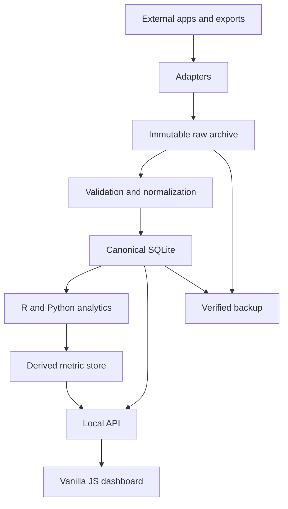

# Architecture
Proposed defaults, subject to repository audit: semantic HTML/CSS/vanilla JS ES modules; ECharts for charts, D3 only for specialized visuals, Anime.js or CSS for motion; Python/FastAPI local backend; SQLite; R statistical engine; optional Parquet for demonstrated scale. OCaml only with justified need. Tauri optional after core stability. No React/Next/Vue/Angular or remote database.

## Boundaries
Adapters own provider schemas/authentication; ingestion owns validation, idempotency and source reconciliation; repositories own persistence; analytics own versioned calculations; API owns contracts; UI never directly reads database or provider tokens. Background jobs use bounded retries, cursors and transactional writes. Serve frontend and API on loopback, preferably same origin. Use XDG data/config/cache paths. Store raw payloads with hashes and manifests; preserve source records when deduplicating canonical events.
## Suggested layout
frontend/{pages,components,styles,charts,services,assets}; backend/{api,core,models,repositories,integrations,ingestion,normalization,services,security}; analytics/{R,metrics,reports}; database/migrations; tests/{unit,integration,fixtures,end_to_end}; scripts; docs. Adapt rather than replace existing layout.
## API contracts (proposed)
GET /api/v1/metrics, /series, /sources, /imports, /health; POST /imports, /sources/{id}/sync, /analysis/correlation, /backups. Define typed schemas, pagination, units, timezone, error codes and data completeness. Mutating endpoints require local request protections. Version contracts and generate OpenAPI documentation.
